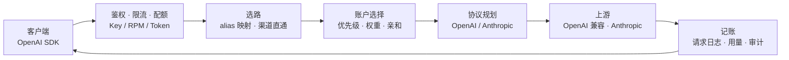

<p align="center">
  
</p>

<h1 align="center">Portara</h1>

<p align="center">企业级 AI API 网关 —— 一个端口，统一多家上游</p>

[](LICENSE)
[](package.json)
[](package.json)
[](package.json)


Portara 部署在应用与模型服务之间，对外只暴露一个 OpenAI 兼容入口：密钥、限流、
配额、选路与成本计量都收在这一层，业务代码里不必再出现任何上游凭证。

三条主线：

- **渠道 × 账户双层选路与会话亲和** —— 先在一组「渠道 + 上游模型」里挑，再在渠道内的一组账户里挑；
  同一会话固定落在同一目标上，复用上游的前缀缓存。
- **余额额度适配器驱动轮转** —— 按厂商接口读取余额与用量窗口，见底或打满的账户被主动跳过。
- **OpenAI ⇄ Anthropic 协议翻译** —— 上游讲什么协议由渠道决定，客户端始终只说 OpenAI。

## 特性

- **单端口**：管理面板（Vue 3 SPA）、控制面 `/api/*` 与数据面 `/v1/*` 同进程同端口，一个容器即一套完整服务。
- **OpenAI 兼容**：对话、补全、向量化、Responses 与模型列表；流式响应字节级透传，不在转发路径上反序列化整条 SSE。
- **多上游账户与优先级权重**：一个渠道可挂多个账户，按优先级梯队 + 权重轮转；单个账户失效/限流时自动换号，重试状态码与次数都有上限。
- **会话亲和**：客户端显式给出的 `prompt_cache_key` 经加权 rendezvous 哈希落到固定 `(渠道, 账户)`，存于 Redis 并带 TTL；只存哈希，日志仅留前 8 位。
- **冷却与窗口熔断**：失败过的目标在冷却期内不再被路由（鉴权类错误与 `Retry-After` 取更长值）；任一用量窗口打满的账户直接跳过。
- **余额适配**：适配器是纯函数（拉取 + 解析分离），新增一家厂商只需加一条 endpoint/parse 与一行 UI 选项；快照有缓存，避免把上游余额接口打成限频。
- **审计**：密钥查看、设置变更等敏感操作逐条留痕，且**写不进审计就让操作失败**（fail-closed），列表接口只返回前缀。
- **中英双语与明暗主题**：文案全部走 i18n，无 UI 框架、手写 CSS 与自绘控件。

## 快速开始

### 1. 前置

| 依赖 | 版本 |
| --- | --- |
| Node.js | **22.12+** |
| pnpm | **11**（`corepack enable` 后自动取 `packageManager` 指定版本） |
| Docker | 任意近期版本，带 Compose v2 |

### 2. 最小可跑（依赖容器化，应用跑在宿主机）

```bash
cp .env.example .env      # 至少填好 PORTARA_MASTER_KEY / PORTARA_SESSION_SECRET
docker compose up -d postgres redis
pnpm install
pnpm build && pnpm start   # 前端产物 + 后端编译，然后单端口启动
```

打开 <http://127.0.0.1:52740/>，用 `.env` 里的 `PORTARA_ADMIN_USERNAME` / `PORTARA_ADMIN_PASSWORD`
登录；在「API 密钥」里派发一把 Key（明文只出现一次），即可调用：

```bash
curl http://127.0.0.1:52740/v1/chat/completions \
  -H "Authorization: Bearer sk-portara-..." \
  -H "Content-Type: application/json" \
  -d '{"model":"<网关模型 ID>","messages":[{"role":"user","content":"你好"}]}'
```

### 3. 全容器化

```bash
pnpm app:up     # docker compose --profile app up -d --build
pnpm app:down   # 停掉并移除应用容器
```

需先在 `.env` 里提供 `PORTARA_MASTER_KEY`、`PORTARA_SESSION_SECRET`、`PORTARA_ADMIN_PASSWORD`，
compose 会以 `${VAR:?}` 的形式强制要求它们存在。

### 4. 本地开发

```bash
pnpm dev       # 后端，tsx watch 热重载
pnpm dev:web   # 前端，vite，自动把 /api 与 /v1 代理到后端
```

`pnpm start` 跑的是**构建产物**：改完服务端源码要先 `pnpm build` 再重启，否则端口上仍是旧代码。

## 架构



- **选路是两层**：先由 alias 映射（一个网关模型 ID 对一个或多个「渠道 + 上游模型」）给出渠道候选序列，
  没有映射时按渠道声明的模型直通；再由账户选择在候选渠道内部给出账户序列。
- **故障转移按层退化**：可重试的状态码才换目标；每个渠道有独立的超时上限、重试次数有上限，客户端断开即取消上游请求，避免幽灵计费。
- **记账不挡响应**：计量与日志异步落库；上游未返回 `usage` 时按字节量估算，并显式标记为估算值。

## 对外端点

| 端点 | 说明 |
| --- | --- |
| `POST /v1/chat/completions` | 对话补全，支持 `stream: true`（SSE 透传） |
| `GET /v1/models` | 聚合各启用渠道声明的模型；`?filter=mirror-only\|origin-only` 可按映射关系过滤 |
| `GET /v1/usage` | 各渠道的余额/用量快照，需该 Key 开启读取权限 |
| `GET /healthz` | 进程存活 |
| `GET /readyz` | 就绪检查（含 PostgreSQL 与 Redis） |
| `/api/*` | 管理控制面，供面板使用；完整接口见 `server/src/routes/` |

其余 `/v1/*` 请求走通用透传，同样经过鉴权、限流与计量。

## 配置与安全

- **上游密钥加密**：渠道与账户的 Key 以 AES-256-GCM 信封加密存储，主密钥来自 `PORTARA_MASTER_KEY`
  （32 字节 base64）；缺失时开发模式回退到内置弱密钥并**在启动日志里高声告警**，生产必须显式提供。
- **客户端 Key 双存**：鉴权用 SHA-256 哈希，另存一份可解密的密文以支持管理员查看——代价是
  数据库与主密钥同时泄漏时 Key 可被解密，故查看接口仅管理员可用且每次都写审计。不要密文的话清空该列即可。
- **审计 fail-closed**：敏感操作先写审计再返回，写不进去就整体报错，不静默放过。
- **默认口令必须改**：`PORTARA_ADMIN_PASSWORD` 留空会生成随机初始密码并打印一次；
  仍为默认值时服务启动会告警。生产走 HTTPS 时把 `PORTARA_COOKIE_SECURE` 置 `true`。
- **数据库迁移只增不改**：已发布的迁移永不修改，修正靠新增一条；测试与开发数据用独立 schema 隔离。
- **会话令牌短效**：access 是无状态 JWT（默认 15 分钟），长效交给可撤销、会轮换的 refresh token（默认 30 天）。

## 文档

| 文档 | 内容 |
| --- | --- |
| [CONTRIBUTING](CONTRIBUTING.md) | 贡献流程与验收门 |
| [AGENTS](AGENTS.md) | 本仓库的 AI 协作约束与五条铁律 |

> 架构决策记录（D-xxx）、交接文档、里程碑路线等内部资料不随仓库分发，由维护者单独保管。

## 贡献

```bash
pnpm typecheck && pnpm build && pnpm test && pnpm smoke
```

四条全绿才算改完。端到端冒烟会连**隔离 schema** 与伪上游，不碰开发/生产数据，也不消耗真实额度。
提交前请保持既有风格：中文注释、对外字段一律 camelCase、前端手写 CSS 不引入 UI 框架。

## 许可证

[AGPL-3.0](LICENSE)。以网络服务形式对外提供本软件（含私有化交付）时，必须向使用者提供完整对应源码。

版权所有 © 2025-2026 云矩数阁网络科技（贵州省）有限责任公司

---

**名字由来**：Portara（πόρτα，「门」）是希腊纳克索斯岛上阿波罗神庙遗址仅存的一扇巨型大理石门框 ——
没有墙、没有殿，只剩入口本身。这个项目要做的也是一道门：所有 AI 流量从这里经过，而门本身不该成为负担。
