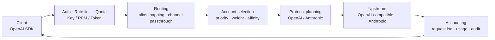

<p align="center">
  
</p>

<h1 align="center">Portara</h1>

<p align="center">Enterprise-grade AI API Gateway</p>

<p align="center">
  <a href="LICENSE"></a>
  <a href="package.json"></a>
  <a href="package.json"></a>
  <a href="package.json"></a>
  <a href="https://github.com/Crequency/Portara/actions/workflows/ci.yml"></a>
  <a href="https://github.com/Crequency/Portara/stargazers"></a>
</p>

Portara sits between your applications and the model providers behind them and exposes a single
OpenAI-compatible endpoint. Credentials, rate limits, quotas, routing and cost accounting all live
in this layer, so no upstream secret ever appears in business code. One process serves the data
plane, the admin API and the web console on the same port.

## Features

- **Single endpoint** — the `/v1/*` data plane, the `/api/*` control plane and the Vue console share one process and one port; a single container is a complete deployment.
- **OpenAI-compatible streaming** — chat, completions, embeddings, responses and model listing; SSE bytes are forwarded as-is instead of being re-serialized on the proxy path.
- **Channel × account routing with session affinity** — an alias maps one gateway model to one or more channel/model pairs, each channel holds multiple accounts ranked by priority and weight, and a client-supplied `prompt_cache_key` pins a conversation to the same `(channel, account)`.
- **Balance & quota adapters** — vendor balance and usage windows are read by small fetch/parse pairs, so exhausted or cooling targets are skipped before they are used.
- **OpenAI ⇄ Anthropic translation** — the channel decides which protocol the upstream speaks; clients only ever speak OpenAI.
- **Encrypted key storage with audit** — upstream keys are sealed with AES-256-GCM, and sensitive reads and writes are recorded and fail closed.
- **Bilingual, hand-written UI** — English and Chinese copy through i18n, custom CSS and hand-built controls, with no UI framework.

## Quick Start

Node.js 22.12+ and pnpm 11 are required; PostgreSQL and Redis come from Compose.

```bash
cp .env.example .env                        # set PORTARA_MASTER_KEY and PORTARA_SESSION_SECRET
docker compose up -d postgres redis
pnpm install && pnpm build && pnpm start
```

Open <http://127.0.0.1:52740/>, sign in with the administrator account from `.env`, issue a key
and call the gateway with any OpenAI SDK.

## Architecture



Routing happens twice: the alias mapping yields an ordered list of channels, then account selection
yields an ordered list of accounts inside the chosen channel. Failover walks those lists, and only
retryable status codes move a request to the next target.

## Endpoints

| Endpoint | Description |
| --- | --- |
| `POST /v1/chat/completions` | Chat completions, including `stream: true` over SSE |
| `GET /v1/models` | Models declared by every enabled channel |
| `GET /v1/usage` | Balance and usage snapshots for the calling key |
| `GET /healthz` | Liveness of the process |
| `GET /readyz` | Readiness, including PostgreSQL and Redis |
| `/api/*` | Admin control plane used by the console |

Other `/v1/*` paths pass through the same authentication, rate limiting and accounting.

## Security

- **Envelope encryption** — channel and account credentials are sealed with AES-256-GCM under a master key supplied through `PORTARA_MASTER_KEY`.
- **Hashed and encrypted client keys** — authentication uses a SHA-256 hash, while a separate sealed copy lets an administrator reveal a key on demand; every reveal is audited.
- **Fail-closed audit** — an operation that cannot be written to the audit log fails instead of proceeding silently.
- **Short-lived tokens** — access tokens are stateless JWTs measured in minutes; long sessions ride revocable, rotating refresh tokens.
- **Additive migrations only** — published migrations are never edited and corrections always arrive as new ones.

## License

[AGPL-3.0](LICENSE). Running a modified copy as a network service requires offering its complete corresponding source.

Copyright © 2025-2026 Crequency Open Source Organization （云矩创频开源组织）

## Star History

<p align="center">
  <a href="https://www.star-history.com/#Crequency/Portara&Date&dark">
    
  </a>
</p>
